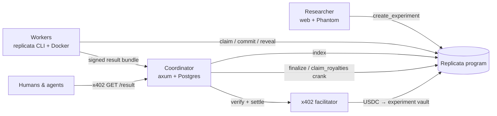

# Replicata

**Verifiable, paid replication of computational experiments on Solana.**

A researcher publishes an experiment (a Docker image pinned by digest + a command) with a USDC
reward escrowed on-chain. Anyone with a CPU replicates it with one command, commits the hash of
the output and reveals it later; a strict majority of matching results is paid automatically
and disagreeing replicators lose their bond. The verified result is then sold over **x402** to
humans and AI agents, and every sale is split between the author and the replicators.

> Encode Club × Solana Hackathon 2026 — tracks **Best Use of x402 on Solana** and
> **Best Consumer App on Solana**.

## Why

Producing science is being automated; verifying it is not. ~21 % of ICLR 2026 reviews were
LLM-generated, journal submissions grew +33 % year over year and fabricated citations went from
1 in 2,828 (2023) to 1 in 277 (2026), while 70 % of researchers could not reproduce someone
else's work (Nature) and agents reproduce papers poorly (CORE-Bench Hard ≤ 21 %).
Reproducible verification is what is scarce — and today nobody is paid for it.

## How Solana runs the product

| | On-chain (Anchor program) | Why Solana |
|---|---|---|
| **Escrow** | `create_experiment` locks the reward in a vault PDA; workers lock a bond in `claim` | Cheap, programmable USDC escrow without a custodian |
| **Commit-reveal** | `commit(sha256(H ‖ salt ‖ worker))` then `reveal(H, salt)` | Nobody can copy someone else's result; the commitment binds the worker key |
| **Settlement** | Permissionless `finalize`: strict majority ≥ k → pays reward + confiscated bonds to the agreeing workers; otherwise refunds | Trust-minimised payout, reputation (`WorkerProfile`) on-chain |
| **x402 royalties** | Paid access to the result settles USDC **into the experiment vault**; `claim_royalties` splits it (e.g. 70 % author / 30 % replicators) | Every access pays whoever produced *and* whoever verified |
| **Agents** | `POST /v1/experiments` paid over x402 returns a transaction the agent signs | Agents publish and consume science without accounts |

## Architecture



More: [`docs/ARCHITECTURE.md`](docs/ARCHITECTURE.md) · API: [`docs/API.md`](docs/API.md) ·
demo: [`docs/DEMO-SCRIPT.md`](docs/DEMO-SCRIPT.md).

| Path | What |
|---|---|
| `programs/replicata` | Anchor 1.2 program: 8 instructions (`create_experiment`, `cancel_experiment`, `claim`, `commit`, `reveal`, `finalize`, `claim_royalties`, `withdraw_bond`) |
| `crates/core` | Canonical `JobSpec` + `spec_hash`, canonical output hash `H`, commitment, bundles |
| `crates/client` | PDAs and instruction builders (on top of the program's Anchor types) |
| `crates/coordinator` | Indexer, specs and bundles store, x402 paywall (`x402-axum`), finalize/royalties crank, OpenAPI |
| `crates/worker` | `replicata` CLI: deterministic Docker sandbox, resumable commit-reveal, x402 client |
| `crates/facilitator` | Self-hosted x402 facilitator for `solana-test-validator` (localnet only) |
| `apps/web` | Next.js 16 + wallet-ui + Codama client + `@x402/fetch` |
| `examples/experiments` | Demo experiments (π Monte-Carlo, integer Lorenz, a deliberately non-reproducible one) |
| `tests`, `e2e` | LiteSVM program tests and full-stack end-to-end tests |

## Quick start (local, 5 minutes)

Requirements: Rust, Solana/Agave CLI 4.1 + Anchor 1.2.1, Docker, Node 24+ and pnpm.

```bash
anchor build                          # program + IDL
scripts/localnet.sh start             # validator + program + local USDC + funded keys + x402 facilitator + Postgres
scripts/coordinator-local.sh &        # coordinator on http://127.0.0.1:8787
pnpm install && NEXT_PUBLIC_CLUSTER=localnet NEXT_PUBLIC_RPC_URL=http://127.0.0.1:8899 pnpm web:dev

# replicate as a worker (each keypair is a different worker)
cargo run -p replicata-worker -- --keypair .localnet/keys/worker1.json run --once <experiment>

# publish as an agent, paying the fee over x402
cargo run -p replicata-worker -- --keypair .localnet/keys/agent.json publish examples/experiments/pi-montecarlo/publish.json

# buy a verified result over x402
cargo run -p replicata-worker -- --keypair .localnet/keys/consumer.json buy <experiment>
```

On devnet: fund a Phantom wallet (testnet mode) with SOL (faucet.solana.com) and USDC
(faucet.circle.com), then `curl -sSf https://<site>/install.sh | sh && replicata init`.

## Tests

| Layer | Command | What it proves |
|---|---|---|
| Core | `cargo test -p replicata-core` | Canonical encodings (unit + property tests + cross-language vectors) |
| Program | `anchor build && cargo test -p replicata-program-tests` | Every instruction path and error, attacks on `remaining_accounts`, and a property test that **no USDC is ever created or lost** |
| Coordinator | `cargo test -p replicata-coordinator` | Routes, x402 guards, replay protection, 402/409/503 mapping (Postgres + mocked facilitator) |
| Worker | `cargo test -p replicata-worker` | Sandbox (no network, read-only, non-root, timeout), resumable state, demos are bit-identical across runs **and architectures** |
| End-to-end | `scripts/e2e-local.sh 3` | Real validator + facilitator + Docker, 3 runs in a row: happy path with sale and royalties, cheater slashed, non-reproducible refunded, failed/replayed payments, agent publishing, crash recovery |
| Web | `pnpm -C apps/web test && pnpm -C apps/web test:e2e` | Unit + Playwright with an injected wallet; `scripts/web-e2e-real.sh` runs it against the real stack |

CI (`.github/workflows/ci.yml`) runs all of it on every push.

## What existed before 12 Oct 2026

Nothing: the repository, program, services and web were all built during the hackathon.
Only the research and plan were written beforehand.

## Roadmap

ZK (SP1 / RISC Zero) and TEE attestation instead of majority voting · mainnet · Nosana / io.net
as compute backends · IPFS for bundles · third-party disputes with stake · curation DAO.

## License

MIT
