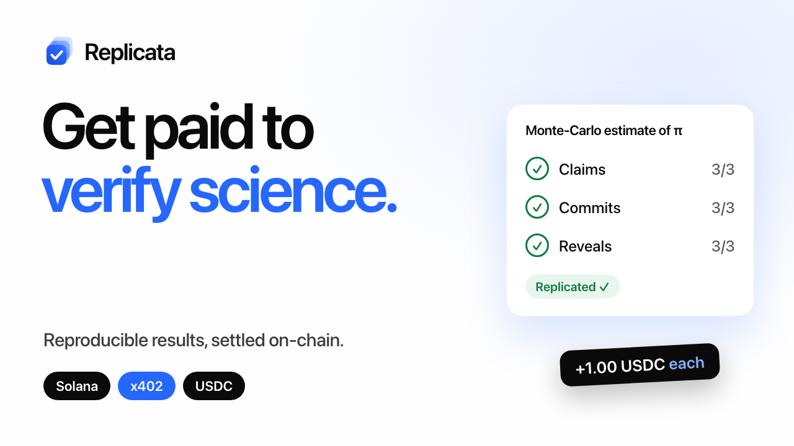
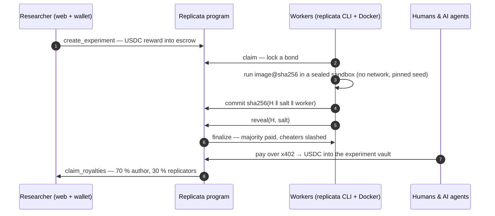
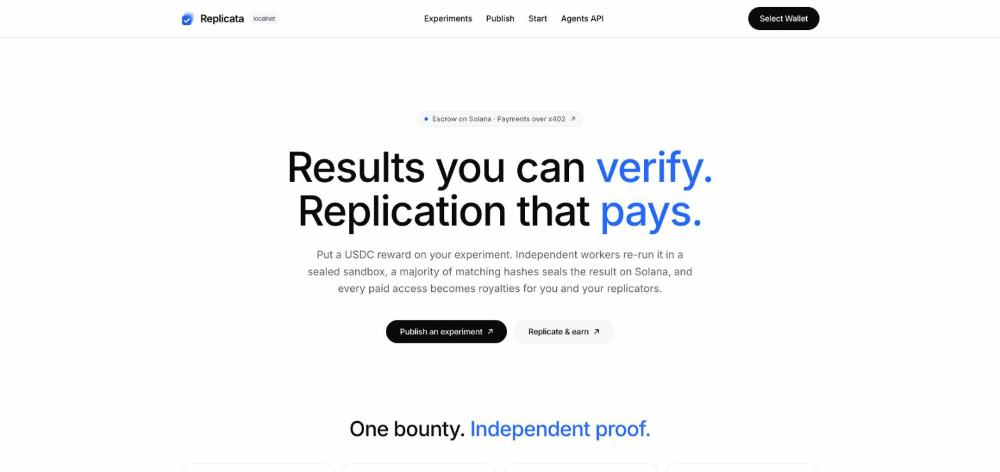
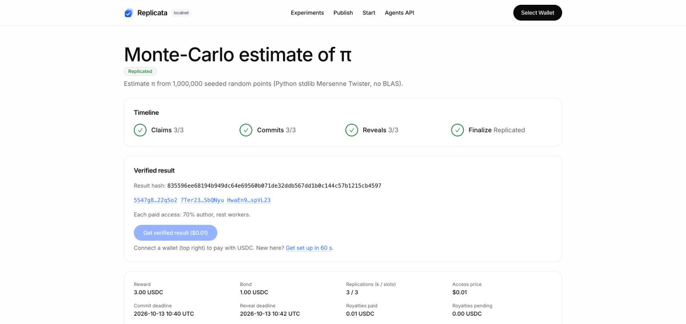
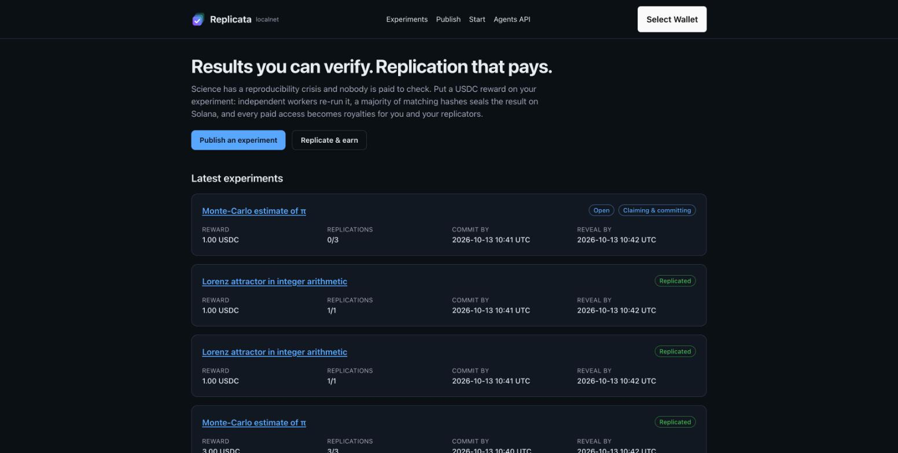
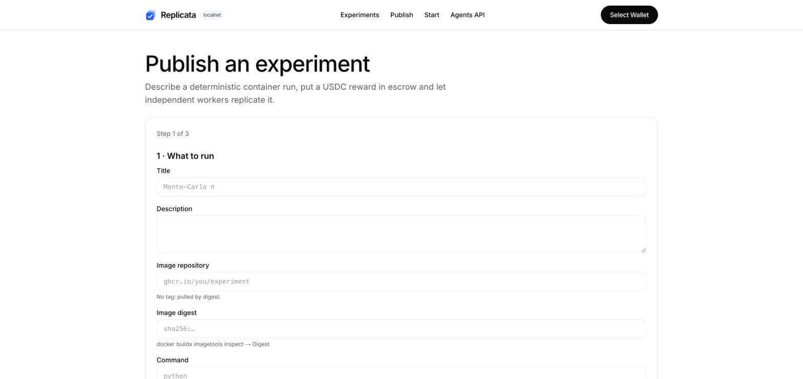
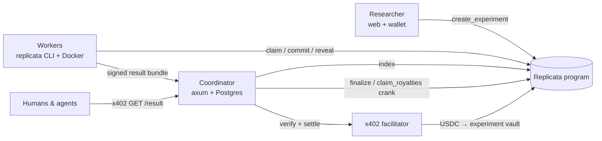

<div align="center">

<picture>
  <source media="(prefers-color-scheme: dark)" srcset="docs/assets/logo-dark.svg">
  
</picture>

### Results you can verify. Replication that pays.

**Escrowed USDC bounties for reproducing computational experiments, settled by commit-reveal majority on Solana, with verified results sold to humans and AI agents over x402.**

[](https://github.com/aralroca/Replicata/actions/workflows/ci.yml)
[](LICENSE)
[](https://replicata.vercel.app)
[](https://youtu.be/4vxmJXJwinE)
[](https://explorer.solana.com/address/G9Ssnp8rjg7gpi4Sm3EZLoC73z9pdXd9etJzUDH39Wj9?cluster=devnet)
[](https://www.x402.org)
<br>
[](https://www.anchor-lang.com)
[](crates)
[](apps/web)
[](https://www.encodeclub.com/programmes/solana-hackathon-2026)

[**Live demo**](https://replicata.vercel.app) · [**▶ Demo video**](https://youtu.be/4vxmJXJwinE) · [Architecture](docs/ARCHITECTURE.md) · [Agents API](docs/API.md) · [Demo script](docs/DEMO-SCRIPT.md) · [Contributing](CONTRIBUTING.md)

<a href="https://youtu.be/4vxmJXJwinE"></a>

<sub>▶ <a href="https://youtu.be/4vxmJXJwinE">Watch the 2-minute demo</a>: publish, three workers replicate, an AI agent pays over x402, royalties, and a dishonest worker slashed.</sub>

</div>

---

## Why

Producing science is being automated; **verifying** it is not.

- ~21 % of ICLR 2026 reviews were LLM-generated, and journal submissions grew 33 % in a year.
- Fabricated citations went from 1 in 2,828 papers (2023) to 1 in 277 (2026).
- 70 % of researchers have failed to reproduce someone else's work (Nature), and AI agents reproduce papers poorly (CORE-Bench Hard ≤ 21 %).

Reproducible verification is the scarce resource, and today nobody is paid for it. Replicata turns
*replicating* into a paid job and a *replicated result* into an asset that earns for whoever produced it
and whoever verified it.

## How it works



1. **Publish.** A researcher describes a deterministic container run (image pinned by digest, command,
   inputs, seed) and escrows a USDC reward on-chain.
2. **Replicate.** Anyone with Docker runs `replicata run`. The worker claims a slot with a bond, runs the
   experiment in a sealed sandbox, commits the hash of the output and reveals it once every slot has committed.
3. **Settle.** A permissionless `finalize` pays the strict majority (reward + confiscated bonds). Disagreeing or
   silent workers lose their bond; a non-reproducible experiment refunds the author.
4. **Sell.** The verified result is served behind an **x402** paywall whose `payTo` is the experiment vault, so every
   access — from a browser wallet or an autonomous agent — becomes royalties for the author and the replicators.

## How Solana runs the product

| | On-chain (Anchor program) | Why it matters |
|---|---|---|
| **Escrow** | `create_experiment` locks the reward in a vault PDA; workers lock a bond in `claim` | Programmable USDC escrow without a custodian |
| **Commit-reveal** | `commit(sha256(H ‖ salt ‖ worker))` then `reveal(H, salt)` | Nobody can copy another worker's result; the commitment binds the worker key |
| **Settlement** | Permissionless `finalize`: ≥ k reveals and a strict majority → agreeing workers paid; withheld reveals forfeit their bond | Trust-minimised payouts and on-chain reputation (`WorkerProfile`) |
| **x402 royalties** | Paid access settles USDC **into the experiment vault**; `claim_royalties` splits it | Every access pays whoever produced *and* whoever verified |
| **Agents** | `POST /v1/experiments` paid over x402 returns a transaction the agent signs | Agents publish and consume science without accounts |

## Screenshots



| Replicated experiment | How it works & feed |
|---|---|
|  |  |

| Publish wizard |
|---|
|  |

## Architecture



| Path | What |
|---|---|
| [`programs/replicata`](programs/replicata) | Anchor 1.2 program: `create_experiment`, `cancel_experiment`, `claim`, `commit`, `reveal`, `finalize`, `claim_royalties`, `withdraw_bond` |
| [`crates/core`](crates/core) | Canonical `JobSpec` and `spec_hash`, canonical output hash `H`, commitments, bundles |
| [`crates/client`](crates/client) | PDAs and instruction builders on top of the program's Anchor types |
| [`crates/coordinator`](crates/coordinator) | Indexer, spec and bundle store, x402 paywall (`x402-axum`), settlement crank, OpenAPI |
| [`crates/worker`](crates/worker) | `replicata` CLI: deterministic Docker sandbox, resumable commit-reveal, x402 client |
| [`crates/facilitator`](crates/facilitator) | Self-hosted x402 facilitator for `solana-test-validator` |
| [`apps/web`](apps/web) | Next.js 16 · wallet-ui · Codama-generated client · `@x402/fetch` |
| [`examples/experiments`](examples/experiments) | Demo experiments: π Monte-Carlo, integer Lorenz attractor, a deliberately non-reproducible one |

Deployed program: [`G9Ssnp8rjg7gpi4Sm3EZLoC73z9pdXd9etJzUDH39Wj9`](https://explorer.solana.com/address/G9Ssnp8rjg7gpi4Sm3EZLoC73z9pdXd9etJzUDH39Wj9?cluster=devnet) (devnet, IDL on-chain).

## Quick start

**Replicate experiments and earn USDC (devnet)**

```bash
curl -sSf https://replicata.vercel.app/install.sh | sh
replicata init                      # creates your key; fund it with devnet SOL + USDC
replicata run --coordinator <url>   # claims, runs, commits and reveals automatically
```

**Run the whole stack locally (≈ 5 minutes)** — needs Rust, Solana/Agave CLI 4.1, Anchor 1.2.1, Docker, Node 24+ and pnpm.

```bash
anchor build                     # program + IDL
scripts/localnet.sh start        # validator, program, local USDC, funded keys, x402 facilitator, Postgres
scripts/coordinator-local.sh &   # coordinator on http://127.0.0.1:8787
pnpm install && NEXT_PUBLIC_CLUSTER=localnet NEXT_PUBLIC_RPC_URL=http://127.0.0.1:8899 pnpm web:dev

# a worker (each keypair is a different worker)
cargo run -p replicata-worker -- --keypair .localnet/keys/worker1.json run --once <experiment>
# an AI agent publishing by paying the fee over x402
cargo run -p replicata-worker -- --keypair .localnet/keys/agent.json publish examples/experiments/pi-montecarlo/publish.json
# an AI agent buying a verified result over x402
cargo run -p replicata-worker -- --keypair .localnet/keys/consumer.json buy <experiment>
```

## Quality

230+ automated tests, all run by CI on every push:

| Layer | Command | What it proves |
|---|---|---|
| Core | `cargo test -p replicata-core` | Canonical encodings: unit, property tests and cross-language vectors |
| Program | `cargo test -p replicata-program-tests` | Every instruction path and error, attacks on `remaining_accounts`, and a property test that **no USDC is ever created or lost** |
| Coordinator | `cargo test -p replicata-coordinator` | Routes, pre-payment guards, replay protection, 402 / 409 / 503 mapping |
| Worker | `cargo test -p replicata-worker` | Sandbox (no network, read-only, non-root, timeout), crash recovery, demos bit-identical **across CPU architectures** |
| End-to-end | `scripts/e2e-local.sh 3` | Real validator + facilitator + Docker, three runs in a row: sale and royalties, cheater slashed, non-reproducible refunded, failed and replayed payments, agent publishing, crash recovery, sabotage |
| Web | `pnpm web:test && pnpm web:e2e` | Unit tests and Playwright with an injected wallet; `scripts/web-e2e-real.sh` runs them against the real stack |

## Roadmap

- ZK (SP1 / RISC Zero) and TEE attestations as alternatives to majority voting
- Mainnet, and Nosana / io.net as compute backends
- IPFS / Arweave for result bundles
- Third-party disputes with stake, and a curation DAO

## Built for the Encode × Solana Hackathon 2026

Tracks: **Best Use of x402 on Solana** and **Best Consumer App on Solana**. Everything in this repository was
built during the hackathon (from 12 October 2026); only the research and the plan existed beforehand.

## License

[MIT](LICENSE) © Aral Roca
