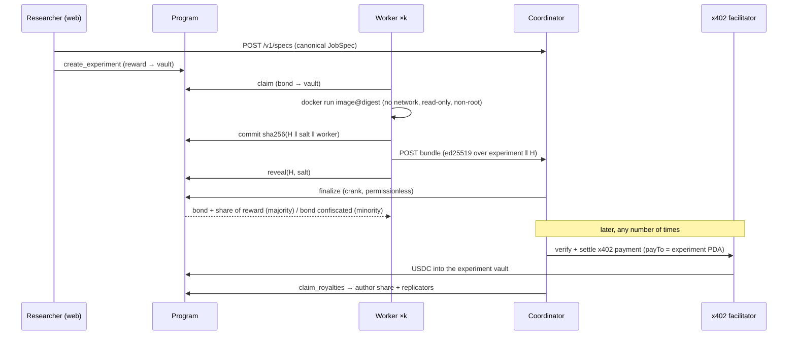

# Architecture and decisions

## Lifecycle

## Canonical encodings (`crates/core`, mirrored in `apps/web/src/lib`)

* `spec_hash = sha256(canonical_json(JobSpec))` — keys sorted bytewise, compact. Checked against
  `vectors/core.json` in Rust and TypeScript.
* `H = sha256(concat(sorted files: name ‖ 0x00 ‖ sha256(bytes) ‖ 0x00))` over `/out`; symlinks
  rejected, stdout excluded. The identity of a bundle is `H`, never the archive bytes.
* `commitment = sha256(H ‖ salt ‖ worker)` — binding the worker key means a public commitment
  cannot be copied and revealed by someone else (`tests/tests/lifecycle.rs`).

## Program rules

* `k ≤ max_claims ≤ 5`: `finalize` pays every revealed claim in one transaction (3 accounts each).
* Reveals open after `commit_deadline`, or early once every slot is taken and committed.
* `finalize` requires **every** revealed claim in `remaining_accounts` (validated: owner,
  discriminator, experiment, uniqueness, token account owner/mint, profile) so nobody can hide a
  dissenter. Replicated iff `reveals ≥ k` and the top hash has a strict majority of reveals.
* Unrevealed bonds are confiscated whenever someone revealed (to the agreeing workers if it
  replicates, to the revealers otherwise — withholding a reveal is never a free veto) and are
  refundable (`withdraw_bond`) only when nobody revealed. Indivisible remainders go to the author.
* The crank recreates missing payout token accounts first, so closing one cannot block settlement.
* `escrowed` tracks what the vault owes; anything above it is royalties. A property test runs
  random lifecycles and asserts conservation of funds.

## Decisions taken during implementation (vs. the plan)

* **Rust client = program crate + `crates/client`** (Anchor `accounts::`/`instruction::` are also
  IDL-derived); Codama generates only the JS client. One less generated artefact to drift.
* **Indexer polls `getProgramAccounts`** instead of a log subscription: simpler and idempotent on
  restart. Endpoints that race the indexer (fresh experiment, bundle right after commit) read the
  account straight from the chain.
* **Specs are uploaded before the transaction** (`POST /v1/specs`, keyed by `spec_hash`), which
  removes ordering problems between the web, the chain and the coordinator.
* **Demo experiments use the official `python` image with stdlib only** (no BLAS), pinned by
  multi-arch digest: bit-identical results on arm64 and x86_64 (checked in CI).
* **x402 on localnet**: public facilitators only know devnet/mainnet, so `crates/facilitator`
  wraps `x402-facilitator-local`. Two `x402-rs` behaviours had to be worked around, both caused
  by RPC reads at `finalized` commitment (~13 s behind): the client's compute-unit estimate
  (`ConfirmedRpc` in `crates/worker/src/pay.rs`) and the facilitator's account reads.
* **Underfunded payers**: facilitators report them as a generic simulation failure; the
  coordinator decodes the payment transaction and answers `402 insufficient_funds` + faucet.

## Security notes

* Sandbox: `--network none`, read-only rootfs, `cap_drop ALL`, `no-new-privileges`, CPU/memory/
  pids limits, tmpfs `/tmp`, hard timeout, runs as the host user (never root).
* Bundles: signature-checked uploads, size-capped, unpacked in memory, links/devices rejected,
  never served before the experiment is `replicated`.
* Payments: settled before the resource is produced; replays rejected (`payments.payment_hash`).
