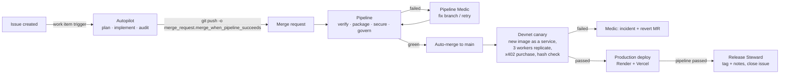

# Replicata on GitLab: an issue becomes a canaried production release

Replicata escrows real money (USDC on Solana) for people who reproduce scientific experiments. A
bad release can lose someone's bond or sell an unverified result, so "it compiles" is not enough
to ship. This is the delivery system we built on GitLab with the Duo Agent Platform: you open an
issue, and the next time you look it is live, released and closed. The only proof that counts is
an experiment that three independent workers actually replicated on devnet.

## Before → after

| | Before (GitHub Actions, manual) | After (GitLab + Duo Agent Platform) |
|---|---|---|
| Plan | Read the issue, decide what to do | **Autopilot** posts a plan and a risk tier |
| Create | Write the code, open a PR | **Autopilot** implements it and pushes with auto-merge |
| Verify | CI: tests | Same tests plus a localnet e2e with Docker workers |
| Secure | Nothing | SAST, secret detection, dependency and container scanning, plus an **escrow-invariant audit** of every diff |
| Package | Image built for one host | Image in the GitLab registry, the CLI as an artifact |
| Release gate | "Tests passed" | **Devnet canary:** the exact image runs as a service and must take a real experiment from publish to a verified x402 purchase |
| Deploy | Manual (Vercel CLI, Render dashboard) | Gated production deploy of the canaried image |
| Release | Manual tag | **Release Steward** tags a semver release with notes |
| Monitor | A keepalive ping | Scheduled canary; **Pipeline Medic** opens an incident and a revert |
| Govern | None | License audit (880 crates, 169 packages), CODEOWNERS on the on-chain program |

## The loop

**Autonomy follows blast radius.** Off-chain changes (web, coordinator, worker, docs, CI) merge
themselves when everything is green. Changes to the on-chain escrow program go through the same
agents and gates, but `.gitlab/CODEOWNERS` plus "code owner approval" on `main` keep the
auto-merge waiting for a human, because that code holds people's money.

## The nine stages

| Stage | Where |
|---|---|
| **Plan** | Autopilot `planner`: plan, files, acceptance check and risk tier on the issue |
| **Create** | Autopilot `implementer`: branch, change, tests, Conventional Commit, `git push -o merge_request.*` |
| **Verify** | `rust:lint` (program build + committed IDL check), `rust:test`, `e2e:localnet`, `web:test` |
| **Package** | `package:image` (registry image tagged by commit), `package:cli` (worker binary) |
| **Secure** | `semgrep-sast`, `secret_detection`, `gemnasium-dependency_scanning`, `container_scanning`, and the Autopilot `escrow_auditor`, which can cancel the auto-merge |
| **Release** | `canary:devnet` gate, then Release Steward tags `vX.Y.Z`; the `release` job publishes it with the binary |
| **Configure** | `.gitlab/duo/agent-config.yml` (agent sandbox and network policy), environment-scoped CI variables, `staging` and `production` environments |
| **Monitor** | Scheduled `canary:devnet` and `monitor:health`; Pipeline Medic turns failures into incidents |
| **Govern** | `govern:licenses:rust` / `govern:licenses:js` (OSI-only audit with an artifact), CODEOWNERS approval, protected `main` |

## Files

| Path | What |
|---|---|
| [`.gitlab-ci.yml`](../.gitlab-ci.yml) | The pipeline |
| [`.gitlab/duo/flows/autopilot.yml`](../.gitlab/duo/flows/autopilot.yml) | Planner → implementer → escrow auditor |
| [`.gitlab/duo/flows/pipeline-medic.yml`](../.gitlab/duo/flows/pipeline-medic.yml) | Pipeline failed: repair, retry, or incident + revert |
| [`.gitlab/duo/flows/release-steward.yml`](../.gitlab/duo/flows/release-steward.yml) | Pipeline passed on `main`: release and close the loop |
| [`.gitlab/duo/agent-config.yml`](../.gitlab/duo/agent-config.yml) | Agent sandbox image, cache and network allow-list |
| [`.gitlab/CODEOWNERS`](../.gitlab/CODEOWNERS) | Human approval for the on-chain program and the automation itself |
| [`scripts/ci/devnet-canary.sh`](../scripts/ci/devnet-canary.sh) | The release gate |
| [`scripts/ci/license-audit.sh`](../scripts/ci/license-audit.sh) | The governance gate |

The flow files use the AI Catalog sync format (`name`, `description`, `definition`, `consumers`).
The `definition` block is exactly what is registered in the project's AI Catalog.

## What moving to GitLab found

Running the existing suite on GitLab's shared runners exposed two real bugs in the worker. Both are
now fixed, with regression tests:

- **The sandbox could run experiments as root.** It ran containers as the owner of the output
  directory, which is root whenever the worker itself is root (servers, CI). It now hands the
  directory to `nobody`. Caught by `never_runs_as_root` on a root runner.
- **Remote Docker engines were rejected.** `DOCKER_HOST=tcp://…` failed with "cannot reach
  Docker". Caught by Docker-in-Docker.

The devnet canary, on its first local run, also caught a stale worker binary that crashed after
claiming a slot. That is exactly the failure it exists to stop before production.

## Run it yourself

1. Fork or import the project and enable the three flows from `.gitlab/duo/flows/`. Triggers:
   - Autopilot: work item created, mention, assign.
   - Pipeline Medic: pipeline failed.
   - Release Steward: pipeline passed.
2. CI/CD variables for the gated jobs (all optional; without them those jobs are skipped):
   - `CANARY_KEYS` (file): `{"author","worker1","worker2","worker3","consumer"}` devnet keypairs
     with SOL and devnet USDC.
   - `STAGING_CRANK_KEYPAIR`: base58 keypair for the canary's own coordinator.
   - `VERCEL_TOKEN`, `VERCEL_ORG_ID`, `VERCEL_PROJECT_ID`, `RENDER_DEPLOY_HOOK` for production.
3. Open an issue with the **Autopilot** template.
